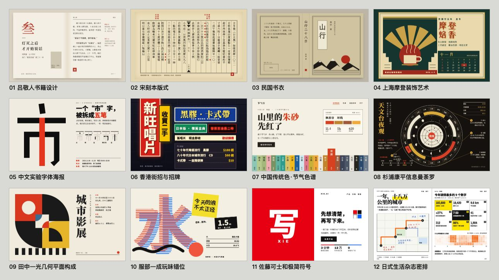
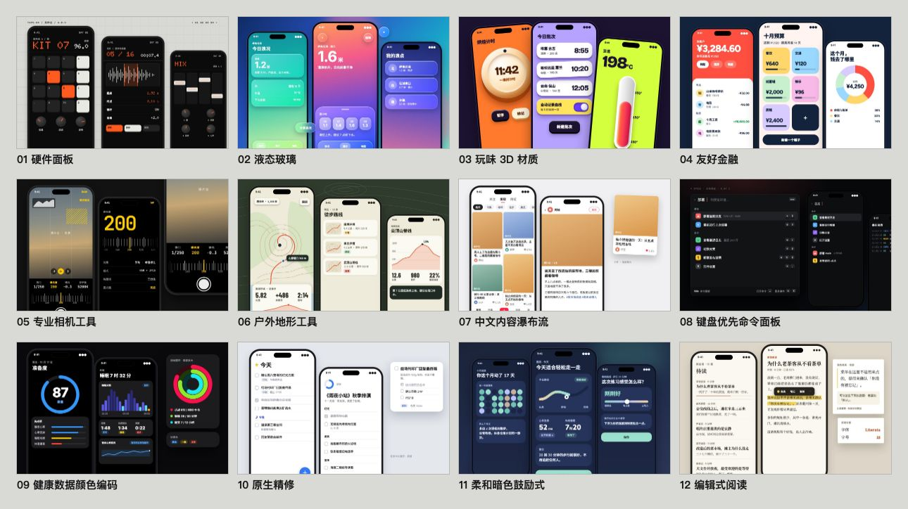

<sub>🌐 <b>English</b> · <a href="README.zh.md">中文</a></sub>

> **NOTICE:** English translation of [huashu-design](https://github.com/alchaincyf/huashu-design) by alchaincyf, MIT License.

<div align="center">

# Huashu Design

> *"Type. Hit enter. A finished design lands in your lap."*
> *「打字。回车。一份能交付的设计。」*

[](LICENSE)
[](https://skills.sh)
[](https://skills.sh)

<br>

**Type one sentence into your agent and get back a design you can ship.**

<br>

In 3 to 30 minutes, you can ship a **product launch animation**, a clickable App prototype, an editable PPT deck, or a print-grade infographic.

Not "decent for AI" quality. It looks like a big-company design team made it. Give the skill your brand assets (logo, color palette, UI screenshots) and it reads your brand's character; give it nothing and **three real directions picked from six thumbnails, plus an 84-style library with a specimen for every style**, still keep you out of AI slop.

**Every page of design you see in this README was made by huashu-design itself.** Not Figma, not After Effects, just a one-sentence prompt and a skill run. Need a promo video for your next product launch? Now you can make it too.

```
npx skills add alchaincyf/huashu-design
```

Works across agents: Claude Code, Cursor, Codex, OpenClaw and Hermes can all install it.

> 📣 **Now under the MIT License.** As of 2026-05-14 this skill is fully open source ([MIT License](LICENSE)), **free for personal and commercial use**, with no prior authorization needed. The old "free for personal use, commercial use by companies requires authorization" terms are void. ([See what changed](#license))

> 🆕 **3.0: bolder directions, and projects that no longer all look alike.** Six thumbnails come first, then three are picked and made into real designs; the style library grows to 84 (new App and Chinese & East Asian sections), each with a specimen; reference works are screenshotted before any work starts; plus a design check that only measures facts, and a look ledger that remembers what your past work looked like. [See Core Mechanics](#core-mechanics)

[See it work](#30-showcase) · [Install](#install) · [What it does](#what-it-does) · [Core Mechanics](#core-mechanics) · [Relationship with Claude Design](#relationship-with-claude-design)

</div>

---

<p align="center">
  
</p>

<p align="center"><sub>
  ▲ 3.0 launch film · 32s · every page of design in it was made by 3.0 itself; edited with <a href="https://github.com/alchaincyf/huashu-motion">huashu-motion</a><br>
  👉 <a href="https://github.com/alchaincyf/huashu-design/releases/download/v3.0.0/launch-3.0.mp4">Download MP4 (1080p · with music · 24MB)</a> ·
  The 2.0 interactive HTML version with sound effects (upstream site, not linked in dstack)
</sub></p>

---

## 3.0 Showcase

Everything below was made with 3.0. The first five are picked from 6 fresh prompts run for the launch: each got only a one-sentence brief, the agent picked the direction itself, and the author didn't step in. Of the last two, one is the version that won the third blind-pick round, and the other is a real project the author built with it after release.

### Web · *Thirty-six Views of Mount Fuji* online exhibition

> "Make an online exhibition website for Hokusai's *Thirty-six Views of Mount Fuji*"

The three versions were a Rijksmuseum-site-style dark gallery, an Ikko Tanaka-style triangle window, and a Republic-era book-jacket title frame. The design check flagged one collision: two versions both opened with *The Great Wave off Kanagawa*, so it switched the dark-gallery version to *Rainstorm Beneath the Summit*.

<p align="center"></p>

Further down, a chapter covers Prussian blue, based on the Met's spectral research; all 46 prints come from the open-access collections of the Art Institute of Chicago and the Met.

<p align="center"></p>
<p align="center"></p>

### App · Mingji (birding log)

> "Make a prototype of a birding log App"

The real-world reference was CapWords, a 2025 Apple Design Award winner. `ref_board.py` first screenshotted it into a reference board, and the agent looked at it before starting. What it borrowed was "peel a sticker out of a photo": every bird is segmented from a real Wikimedia photo and stuck into a year-long notebook, and the call waveforms are computed from real recordings.

<p align="center"></p>

### App · What's for Dinner (home-cooking recipes)

> "Make a home-cooking recipe App"

The seconds roulette happened to land on Lü Jingren's book design, so it ended up as a recipe book: one recipe per page, a margin-note column beside the fore-edge with notes like "pat it dry before frying so the oil won't spit" and "dark soy sauce, just a few drops", and cinnabar reserved for the single "start cooking" seal. The look ledger saw that 5 of the last 6 deliveries had sans-serif headlines, so this version went with Song type.

<p align="center"></p>

### PPT · *A Thousand Li of Rivers and Mountains* lecture

It took the best-designer route with an Abbott Miller-style dark display case; the dark ground is sampled from the darkest part of the silk. The long thin position bar under the cover is a thumbnail of the whole scroll, framing which stretch of the 11.9-meter scroll the current slide is on.

<p align="center"></p>
<p align="center"></p>

### PPT · How the black hole photo was taken

The real-world reference was Jonathan Corum's lecture slides: black ground, photos as the protagonist, labels written directly on the image. Every slide cites its source, and facts are checked before they go on a page.

<p align="center"></p>

### App · Green Thumb (the version that won the third blind-pick round)

Reads a plant as living vital signs that breathe. The App prototype is laid out as a composed presentation board, with several phones staggered across it.

<p align="center"></p>

### Web · Travel-living archive (the author's own project)

A map of every travel photo from three years. The pick was a Kaoru Kasai-style long scroll of white paper and Mincho type: a satellite map at the start ties all the trips together, then one chapter per trip further down. After picking it, the author casually said "try not to leave any out", and it saved that as experience: personal memory archives should include every photo, noted as applying only to photo archives and not spilling over into product UIs.

<p align="center"></p>

---

## 📺 Beginner tutorial (recorded by Huashu)

Not sure how to use it? Watch Huashu's getting-started tutorial for huashu-design:

<p align="center">
  <a href="https://www.youtube.com/watch?v=m-_BlUdcIvw"></a>
</p>

<p align="center"><sub>👉 <a href="https://www.youtube.com/watch?v=m-_BlUdcIvw">Watch the full tutorial on YouTube</a></sub></p>

---

## Install

```bash
npx skills add alchaincyf/huashu-design
```

> **Check right after installing**: this skill is more than a single SKILL.md file. The four subdirectories `references/`, `assets/`, `scripts/` and `demos/` hold 99 referenced recipes, scripts and assets, and every one is required. After installing, glance at the install directory (e.g. `~/.claude/skills/huashu-design/`). If you see only SKILL.md and none of those subdirectories, your `skills` CLI is too old (≤1.5.15 had a bug that synced only a single file, fixed in 1.5.19). Upgrade and install again:
>
> ```bash
> npm i -g skills@latest        # or npx skills@latest add alchaincyf/huashu-design
> ```
>
> If it's still wrong after upgrading, fall back to a `git clone` install and clone the repo into any skills directory:
>
> ```bash
> git clone https://github.com/alchaincyf/huashu-design.git ~/.claude/skills/huashu-design
> ```

Then just talk to it in Claude Code, Codex, Cursor or any other agent that supports skills:

```
"Make a keynote deck on AI psychology and recommend 3 style directions for me to pick from"
"Make an iOS prototype of an AI Pomodoro timer, with 4 core screens that are actually clickable"
"Turn this logic into a 60-second animation and export MP4 and GIF"
"Do a 5-dimension review of this design for me"
```

No buttons, no panels, no Figma plugin.

---

## Star History

<p align="center">
  <a href="https://star-history.com/#alchaincyf/huashu-design&Date">
    
  </a>
</p>

---

## What it does

| Capability | Deliverable | Typical time |
|------|--------|----------|
| Interactive prototype (App / Web) | Single-file HTML · real iPhone bezel · clickable · Playwright-verified | 10–15 min |
| Presentation slides | HTML deck (presented in the browser) + editable PPTX (text boxes preserved) | 15–25 min |
| Timeline animation | MP4 (25fps / 60fps interpolation) + GIF (palette-optimized) + BGM | 8–12 min |
| Design variations | 3+ side by side · Tweaks live parameters · cross-dimension exploration | 10 min |
| Infographic / data viz | Print-grade typography · exports to PDF/PNG/SVG | 10 min |
| Design direction advisor | **Three logics, two candidates each** (best designer + award-winning work in the same medium + seconds roulette) · three real designs picked from six thumbnails, the other three kept as alternates | 10 min |
| 5-dimension expert review | Radar chart + Keep/Fix/Quick Wins · actionable fix list | 3 min |

---

## Demo Gallery

### Design Direction Advisor

The fallback for vague briefs: **three complementary logics, two candidates each**. Best designer (the designer best suited to the subject if budget were unlimited) + real-world reference (an award-winning work in the same medium, screenshotted and looked at first) + seconds roulette (a random draw from the style library to break habits). The six candidates are first drawn as one page of thumbnails, and the three strongest and most different become **real designs** for you to choose from by looking, with the other three given to you as alternates. Behind it is an **84-style HTML-native style library** (web 20 + PPT 20 + infographic 20 + App 12 + Chinese & East Asian 12, pure CSS, no image generation needed), each with a specimen.

<p align="center"></p>
<p align="center"><sub>The animation shows the 2.0 flow (each of the three logics produces one version directly)</sub></p>

The two sections new in 3.0. Every cell is a specimen (all pure HTML/CSS, with fictional subjects and numbers):

<p align="center"></p>
<p align="center"></p>

### iOS App Prototype

Precise iPhone 15 Pro body (Dynamic Island / status bar / Home Indicator) · state-driven multi-screen navigation · real images pulled from Wikimedia/Met/Unsplash · automated Playwright click tests.

<p align="center"></p>

### Motion Design Engine

Stage + Sprite time-slice model · four APIs, `useTime` / `useSprite` / `interpolate` / `Easing`, cover every animation need · one command exports MP4 / GIF / 60fps-interpolated / BGM-scored finished videos.

<p align="center"></p>

### HTML Slides → Editable PPTX

HTML decks presented in the browser · `html2pptx.js` reads each element's DOM computedStyle and translates it into PowerPoint objects · the export is **real text boxes**, editable with a double-click in PowerPoint.

<p align="center"></p>

### Tweaks · Live Variation Switching

Color scheme / typeface / information density and more, parameterized · side panel switching · pure frontend + `localStorage` persistence · survives a refresh.

<p align="center"></p>

### Infographic / Data Visualization

Magazine-grade typography · precise CSS Grid columns · `text-wrap: pretty` typographic details · driven by real data · exports to vector PDF / 300dpi PNG / SVG.

<p align="center"></p>

### 5-Dimension Expert Review

Philosophical coherence · visual hierarchy · detail execution · functionality · innovation, each scored 0–10 · radar chart visualization · outputs a Keep / Fix / Quick Wins list.

<p align="center"></p>

### Junior Designer Workflow

No heads-down attempt at a big reveal: write assumptions + placeholders + reasoning first, show it to you early, then iterate. Fixing a misunderstanding early is 100 times cheaper than fixing it late.

<p align="center"></p>

### Brand Asset Protocol · 5-step hard process

Enforced whenever a specific brand is involved: ask → search → download (three fallbacks) → grep color values → write `brand-spec.md`.

<p align="center"></p>

---

## Showcase · Real cases from the 2.0 era

### Parrot evolution website · the design direction advisor's three logics in action (2.0)

> **Live demo · (upstream site, not linked in dstack)**

One sentence, "make a website about the evolution of parrots", with zero extra requirements, and the skill ran the full 2.0 advisor flow on its own: first it judged that images were essential to the content → fetched public-domain natural history illustrations (Edward Lear's and John Gould's parrot plates) → **three logics in parallel** (seconds roulette + an award-winning site as real-world reference + Kenya Hara's "white" philosophy), each producing one real design. **The assets come first, then the design, not color-block placeholders filled in while designing.**

### "Let's Talk Skills" · PM after-party talk deck

> **Live demo · [https://skill-huasheng.vercel.app](https://skill-huasheng.vercel.app)**

A 13-slide HTML deck, **made entirely with huashu-design**:

- A black-ground minimalist serif visual system (cover / about / hook / what / why / closing)
- 2 cinematic demos of 22 seconds each with BGM + SFX (Nuwa skill workflow + Darwin skill workflow), each with a **completely independent visual language**:
  - **Nuwa**: 3D knowledge orbit + Pentagon distillation + SKILL.md typewriter + "21 minutes" hero reveal
  - **Darwin**: autoresearch loop spin + v1/v5 side-by-side diff + full-screen Hill-Climb curve + Ratchet gear lock
- Each cinematic shows the **complete static workflow dashboard** by default (the audience can always see how the skill runs); clicking ▶ triggers the animation, which fades back to the dashboard automatically when it finishes
- The 25-second hero animation from huasheng.ai embedded (iframe with a localized fallback)
- Real data: the real 14,495-stargazer curve (pulled via the gh API) + real DeepSeek V4 specs (verified with WebSearch)
- Real AI assets: `huashu-gpt-image` generates one large 4×2 grid image, `extract_grid.py` cuts it into 8 separate transparent PNGs, which float in a 3D orbit

**Pages worth referencing**:
- `/slides/slide-04b-nuwa-flow.html` · two-layer architecture of a static dashboard + cinematic overlay
- `/slides/slide-06b-darwin-flow.html` · a contrasting case with a completely independent visual language
- `/slides/slide-03b-deepseek-cover.html` · a comparison page of AI slop vs a real designer's perspective

For detailed cinematic patterns, see `references/cinematic-patterns.md`.

---

## Core Mechanics

### Brand Asset Protocol

The hardest rule in the skill. When a specific brand is involved (Stripe, Linear, Anthropic, your own company, etc.), 5 steps are enforced:

| Step | Action | Purpose |
|------|------|------|
| 1 · Ask | Does the user have brand guidelines? | Respect existing resources |
| 2 · Search official brand pages | `<brand>.com/brand` · `brand.<brand>.com` · `<brand>.com/press` | Get authoritative color values |
| 3 · Download assets | SVG files → full HTML of the official site → sample colors from product screenshots | Three fallbacks; when one fails, move to the next immediately |
| 4 · grep color values | Pull every `#xxxxxx` from the assets, sort by frequency, filter out black, white and gray | **Never guess brand colors from memory** |
| 5 · Freeze into a spec | Write `brand-spec.md` + CSS variables, and have all HTML reference `var(--brand-*)` | Anything not frozen gets forgotten |

A/B test (v1 vs v2, 6 agents each): **v2's stability variance was 5 times lower than v1's**. Stability of stability: that is the skill's real moat.

### Design Direction Advisor (Fallback)

Triggered when the user's brief is too vague to start on (rebuilt in 3.0):

- Clarify through conversation first + proactively ask for references (name / logo / brand colors / reference sites you like), asking only one round
- Get all the real images the content needs (public domain / royalty-free, fetched with one script command) before starting
- **Three logics, two candidates each, six in total**: ① Best designer (two designers of different temperaments, building from scratch with their way of thinking) ② Real-world reference (two award-winning works **in the same medium**: an App for an App, publications for a deck; `scripts/ref_board.py` screenshots them first so the agent looks with its own eyes, then breaks down the grid, type-size ratios and color proportions) ③ Seconds roulette (`date +%S` takes the seconds, and draws one number from the section matching the output form and one from the Chinese & East Asian section; look at the specimen before starting)
- **Six thumbnails → three picked to become full designs**: good enough on their own, different from each other, not colliding with your recent projects. The three not picked come along as alternates, and any one that catches your eye gets made next
- **You are never made to pick a style blind without seeing visuals**: it stops once the designs are laid out, and you choose by looking
- Underneath is an **84-style HTML-native style library**, each with a specimen and source (`assets/style-specimens/`), as ammunition, not dogma

Why it works this way: we ran three rounds of before/after blind picks on fixed briefs (internal testing). Round one forced a big metaphor onto every version, pages were turned into props, and it won only 1 of 4 briefs; round two added a pile of bans to dodge the AI default look, all three versions became "too regular, too boring", and it lost both briefs; round three switched to adding options instead of bans (more candidates, visible specimens, real references) and won both of the same two briefs.

### Learns you better the more you use it: experience, look ledger and design check

- **Experience**: before work starts, `scripts/learn.py` brings up your verbatim taste notes ("too plain", "A's structure with C's colors") and past lessons, and at the end of work it records what's worth keeping; it tells you before recording, and you can decline
- **Look ledger**: every delivery logs "what it looked like" (background color, palette, fonts, layout skeleton, along with the project name and path), so the next project proactively steers away. It handles the monotony where each project looks fine on its own but they all look alike side by side
- **Design check**: `scripts/design_lint.py` only measures checkable facts. Broken images, text too small to read, insufficient contrast and console errors are red lights; habitual template chrome like all-caps eyebrow labels and "A · B · C" chains is a yellow light; whether the three versions are reskins of each other, and whether they collide with recent projects, is checked by `compare` and `ledger check`. Whether it looks good is your call; it gives no score
- These records live only on your machine in `~/.huashu-design/`, never ship with the skill, and deleting the folder forgets everything

### Junior Designer Workflow

The default working mode, across every task:

- Before starting, send the user the full question list in one batch, and wait for all the answers before starting work
- Write assumptions + placeholders + reasoning comments into the HTML first
- Show it to the user as early as possible (even if it's just gray blocks)
- Fill in real content → variations → Tweaks, showing again at each of these three steps
- Eyeball it in the browser with Playwright before delivery

### Anti AI-slop rules

Avoid the visual common denominator that screams AI: purple gradients, emoji icons, rounded corners + left border accent, SVG-drawn faces, Inter as display type, and the 2026 generation of template chrome (an all-caps eyebrow label over every heading, "A · B · C" middle-dot chains, a trailing "→" on buttons, one recolored word per headline). No invented data, reviews or logo walls.

"Look families" such as warm paper + serif or dark ground + single accent are not banned: the versions users approved in the blind picks happened to include both. What really needs avoiding is all three versions crowding into the same family, or every project looking the same, and that is handed to the look ledger.

---

## Relationship with Claude Design

I'll openly admit it: the philosophy of the Brand Asset Protocol was learned from the prompts that circulated from Claude Design. Those prompts repeatedly stress that **good hi-fi design doesn't start from a blank page; it grows from existing design context**. That principle is the dividing line between a 65-point design and a 90-point design.

Positioning differences:

| | Claude Design | huashu-design |
|---|---|---|
| Form | Web product (used in a browser) | Skill (used in Claude Code) |
| Quota | Subscription quota | API usage · parallel agents not limited by quota |
| Deliverables | In-canvas + Figma export | HTML / MP4 / GIF / editable PPTX / PDF |
| Interaction | GUI (click, drag, edit) | Conversation (say it, wait for the agent to finish) |
| Complex animation | Limited | Stage + Sprite timeline · 60fps export |
| Cross-agent | Claude.ai only | Any skill-compatible agent |

Claude Design is a **better graphics tool**; huashu-design **makes the graphics-tool layer disappear**. Two paths, different audiences.

---

## Security & Data Flow

The core pipeline (design → render → MP4/PDF/PPTX export) **runs 100% locally, with zero network calls and zero keys**. dstack note: the upstream cloud features (Doubao TTS, Volcengine Ark video review) were removed; narration defaults to a silent/subtitle-only track and video review is local, each with an off-by-default local command hook. No telemetry; no data is ever sent to the author's servers. The local records added in 3.0 (taste experience, look ledger) are written only to `~/.huashu-design/` and never uploaded; the reference board visits those URLs only when you have the agent screenshot reference works. The exhaustive declaration of all outbound domains, key handling and deletion boundaries is in [SECURITY.md](SECURITY.md); you're welcome to have your agent verify it line by line against the code.

---

## Limitations

- **No layer-level editable PPTX to Figma.** The output is HTML: it can be screenshotted, screen-recorded and exported as images, but can't be dragged into Keynote to change text positions.
- **Framer Motion-level complex animation is out.** 3D, physics simulation and particle systems are beyond the skill's boundaries.
- **Designing a completely blank brand from zero drops quality to 60–65 points.** Drawing hi-fi out of nothing was always the last resort.

This is an 80-point skill, not a 100-point product. For people who don't want to open a graphical interface, an 80-point skill is more useful than a 100-point product.

---

## Repository Structure

```
huashu-design/
├── SKILL.md                 # Main doc (read by the agent)
├── README.md                # English README (default, this file)
├── README.zh.md             # Original Chinese README
├── README.en.md             # English README (same as README.md)
├── assets/                  # Starter Components
│   ├── animations.jsx       # Stage + Sprite + Easing + interpolate
│   ├── ios_frame.jsx        # iPhone 15 Pro bezel
│   ├── android_frame.jsx
│   ├── macos_window.jsx
│   ├── browser_window.jsx
│   ├── deck_stage.js        # HTML slide engine
│   ├── deck_index.html      # Multi-file deck assembler
│   ├── design_canvas.jsx    # Side-by-side variation display
│   ├── showcases/           # 24 prebuilt samples (8 scenes × 3 styles)
│   ├── style-specimens/     # Specimens for all 84 styles (html source + jpg) and section overviews
│   └── bgm-*.mp3            # 6 scene-specific background music tracks
├── references/              # Sub-docs to read in depth by task
│   ├── animation-pitfalls.md
│   ├── directions.md        # Three directions: six candidates → thumbnails → pick three
│   ├── design-styles.md     # 84 HTML-native styles (web 20 + PPT 20 + infographic 20 + App 12 + Chinese & East Asian 12)
│   ├── modules/             # Web / deck / infographic / motion module manuals
│   ├── slide-decks.md
│   ├── editable-pptx.md
│   ├── critique-guide.md
│   ├── video-export.md
│   └── ...
├── scripts/                 # Export toolchain
│   ├── render-video.js      # HTML → MP4
│   ├── convert-formats.sh   # MP4 → 60fps + GIF
│   ├── add-music.sh         # MP4 + BGM
│   ├── export_deck_pdf.mjs
│   ├── export_deck_pptx.mjs
│   ├── html2pptx.js
│   ├── design_lint.py       # Design check, color/skeleton collisions across the three versions, look ledger
│   ├── learn.py             # Read/write taste experience
│   ├── ref_board.py         # Screenshot reference works into a reference board
│   ├── capabilities.py      # Detect local capabilities (image generation, sibling skills, Node, ffmpeg)
│   └── verify.py
└── demos/                   # 9 capability demos (c*/w*), Chinese and English GIF/MP4/HTML + hero v10
```

---

## Origin Story

The day Anthropic launched Claude Design, I played with it until 4 a.m. A few days later I realized I hadn't opened it again. Not because it's bad (it's the most mature product in the category right now), but because I'd rather have an agent work for me in the terminal than open any graphical interface.

So I had an agent deconstruct Claude Design itself (including the system prompts circulating in the community, the brand asset protocol and the component mechanics), distill it into a structured spec, then write it as a skill installed in my own Claude Code.

Thanks to Anthropic for writing the Claude Design prompts so clearly. This kind of derivative work inspired by other products is the new form of open-source culture in the AI era.

---

## Products made with huashu-design

The three UI skins of **[FanBox · the cockpit for coding agents](https://github.com/alchaincyf/fanbox)** were designed with huashu-design. Direct Claude Code / Codex as they work, and see every file and every line of change they touched.

[](https://github.com/alchaincyf/fanbox)

---

## Community Translations

Community-maintained translations. Translation quality and the license terms of each version are the responsibility of the corresponding maintainer; please check before using.

| Language | Maintainer | Repository |
|---|---|---|
| English | [@namandhakad712](https://github.com/namandhakad712) | [namandhakad712/huashu-design-en](https://github.com/namandhakad712/huashu-design-en) |
| 한국어 (Korean) | [@ktkarchive](https://github.com/ktkarchive) | [ktkarchive/ktk-design](https://github.com/ktkarchive/ktk-design) |
| Tiếng Việt (Vietnamese) | [@letrquan](https://github.com/letrquan) | [letrquan/huashu-design](https://github.com/letrquan/huashu-design) |

Want to add your language? Fork the repo, translate `SKILL.md` + `README.md`, then come back here and open an issue, and I'll add the link.

---

## License

**Relicensed to MIT as of 2026-05-14.** Earlier versions used a Personal Use License of "free for personal use, commercial use by companies requires authorization", which restricted commercial use. That restriction is now completely removed.

Under the [MIT License](LICENSE) you are free to **use, modify and distribute** this skill, **including for commercial purposes**: internal company use, client deliverables, building it into a paid product to sell, all fine. No prior authorization, no fee, no need to tell anyone. Attribution isn't required, but it's welcome.

---

## Connect · Huasheng (Huashu)

Huasheng is an AI-native coder, independent developer and AI content creator. Notable works: Cat Fill Light (App Store Paid chart Top 1), *A Book on DeepSeek*, Nüwa.skill (30k+ GitHub stars). 300k+ followers across all content platforms.

| Platform | Handle | Link |
|---|---|---|
| X / Twitter | @AlchainHust | https://x.com/AlchainHust |
| WeChat Official Account | 花叔 (Huashu) | Search "花叔" in WeChat |
| Bilibili | 花叔 (Huashu) | (not linked in dstack) |
| YouTube | 花叔 (Huashu) | https://www.youtube.com/@Alchain |
| Xiaohongshu | 花叔 (Huashu) | (not linked in dstack) |
| Official site | huasheng.ai | (not linked in dstack) |
| Developer hub | bookai.top | (not linked in dstack) |

For collaboration inquiries or sponsored content → DM Huasheng on any of the platforms above.

<p align="center"></p>
